# Mise en œuvre - Projet 02

Cette procédure part du serveur `srv-meridian-01` du projet 01, accessible en SSH avec le compte `essotom`.

Convention : `[HOTE]` = poste Windows, `[SRV]` = serveur. `$` = utilisateur standard, `#` = root.

Prendre un instantané de la VM avant de commencer.

---

## 1. Comptes et groupes

### 1.1 Convention de nommage (EX-01)

Les comptes suivent la forme `prenom.nom` :

- tout en minuscules ;
- sans accents ni espaces ;
- un tiret pour les prénoms ou noms composés (`anne-sophie.lefevre-brun`).

Seule exception : `ext.comptable`, dont le nom est imposé par le cahier des charges.

Les 13 comptes et leur service sont listés dans [user.txt](user.txt), au format `compte|service`. Les noms sont inventés.

### 1.2 Groupe principal ou secondaire (EX-08)

Chaque salarié a son **groupe de service** comme groupe principal, et `g_meridian` comme groupe secondaire.

- Le groupe de service dit à quel service appartient la personne. Un salarié n'a qu'un service, et un compte n'a qu'un groupe principal : les deux vont ensemble.
- `g_meridian` regroupe tout le monde. Il ne sert qu'au répertoire `commun`, il a donc sa place en groupe secondaire.

Ce choix ne suffit pas pour les répertoires partagés : un fichier créé dans `commun` prendrait le groupe de service de son créateur. C'est le bit setgid (section 2) qui corrige ça.

### 1.3 Script de création

Le script [script-creation-user.sh](script-creation-user.sh) lit `user.txt` ligne par ligne et, pour chaque compte :

1. crée le groupe `g_meridian` s'il n'existe pas ;
2. crée le groupe de service `g_<service>` s'il n'existe pas ;
3. crée le compte avec son répertoire personnel, le shell `/bin/bash` et son groupe de service comme groupe principal (`useradd -m -s /bin/bash -g`) ;
4. règle l'expiration du mot de passe : 90 jours, avertissement 7 jours avant (`chage -M 90 -W 7`, EX-03) ;
5. ajoute le compte à `g_meridian` (`usermod -aG`) ;
6. pour `ext.comptable`, fixe l'expiration du compte au 31/12/2026 (`chage -E 2026-12-31`, EX-04) ;
7. passe au compte suivant si une commande échoue, et ignore un compte qui existe déjà.

Le script doit être lancé avec `sudo`, depuis le dossier qui contient `user.txt` :

```text
[SRV] $ sudo chmod u+x script-creation-user.sh
[SRV] $ sudo ./script-creation-user.sh
```

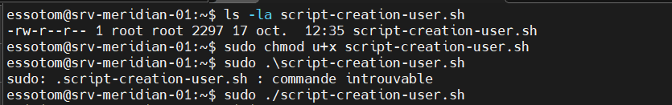

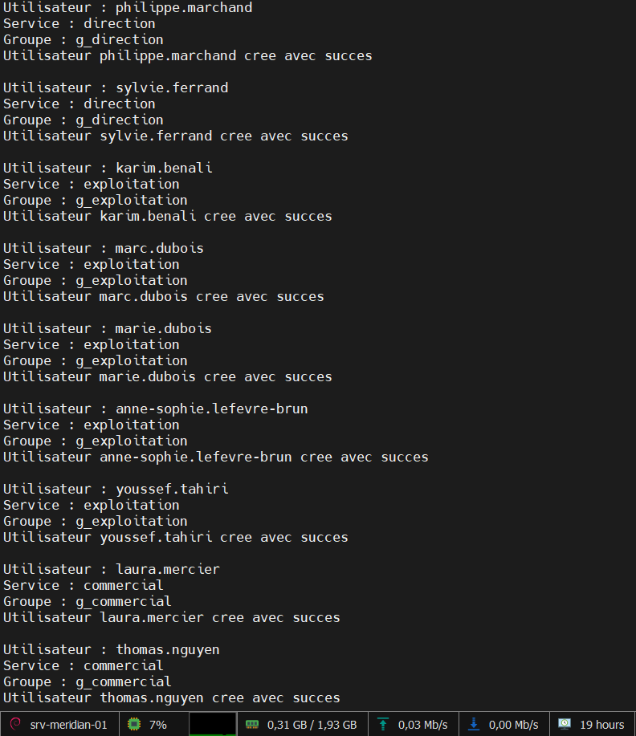

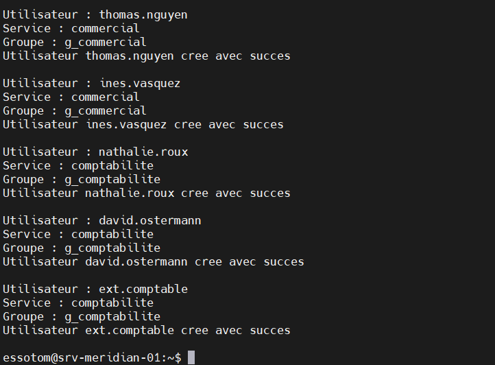

Les répertoires personnels sont créés en `700` (valeur par défaut de Debian 13) :

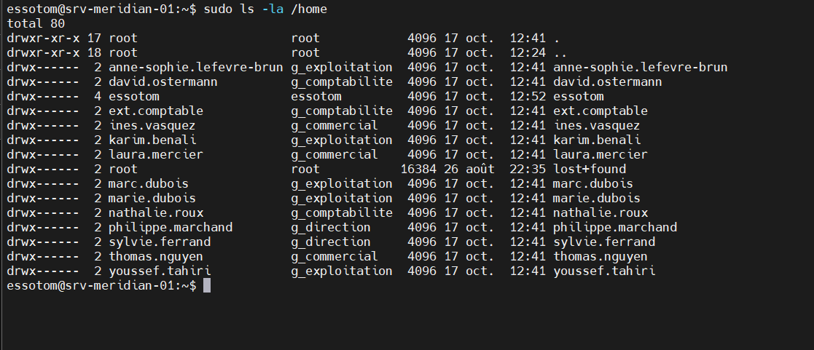

Limites du script :

- Il ne définit pas de mot de passe. Un compte sans mot de passe ne peut pas se connecter avec un mot de passe ; il faut en définir un avec `sudo passwd <compte>`.
- Il ne vérifie pas qu'il est lancé en root : sans `sudo`, chaque commande échoue et le script affiche une erreur par compte.

---

## 2. Arborescence partagée

### 2.1 Création des répertoires (EX-09, EX-10)

Les données partagées vont dans `/srv/meridian`. Le choix de `/srv` est expliqué dans [recherches.md](recherches.md), question 1.

```text
[SRV] $ sudo mkdir -p /srv/meridian/{direction,exploitation,commercial,comptabilite,commun}
[SRV] $ sudo chgrp g_direction    /srv/meridian/direction
[SRV] $ sudo chgrp g_exploitation /srv/meridian/exploitation
[SRV] $ sudo chgrp g_commercial   /srv/meridian/commercial
[SRV] $ sudo chgrp g_comptabilite /srv/meridian/comptabilite
[SRV] $ sudo chgrp g_meridian     /srv/meridian/commun
```

Note : lors de la réalisation, le répertoire `exploitation` a été oublié puis créé plus tard (à 15h01). Les captures ci-dessous ne le montrent donc pas encore. Il apparaît à partir de la capture de la section 2.4.

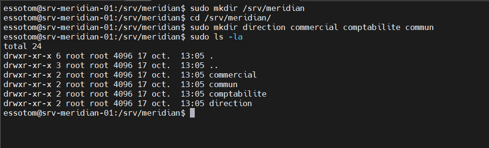

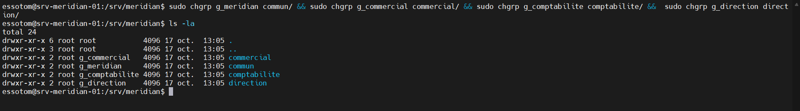

### 2.2 Rappel : effet des permissions

| Permission | Sur un fichier | Sur un répertoire |
|---|---|---|
| `r` | Lire le contenu | Lister les noms des entrées |
| `w` | Modifier le contenu | Créer, supprimer, renommer des entrées (avec `x`) |
| `x` | Exécuter | Traverser le répertoire et accéder aux entrées |

| Droits sur un répertoire | Effet |
|---|---|
| `r--` | Lister les noms, sans pouvoir entrer |
| `--x` | Entrer et ouvrir un fichier dont on connaît le nom, sans lister |
| `r-x` | Lister et entrer, sans rien créer ni supprimer |
| `rwx` | Tout faire |
| `---` | Aucun accès |

Supprimer un fichier dépend des droits `w` et `x` sur le **répertoire**, pas des droits sur le fichier.

### 2.3 Répertoires de service : 2770 (EX-11, EX-13)

EX-11 demande que seuls les membres du service puissent lire, écrire, lister et traverser le répertoire. Il faut donc `rwx` pour le groupe et rien pour les autres : `drwxrwx---`.

EX-13 demande qu'un fichier créé dans le répertoire prenne le groupe du service. C'est le rôle du bit setgid, qui vaut `2000` en octal. On obtient `drwxrws---`, soit `2770`.

```text
[SRV] $ sudo chmod 2770 /srv/meridian/direction /srv/meridian/exploitation /srv/meridian/commercial /srv/meridian/comptabilite
```

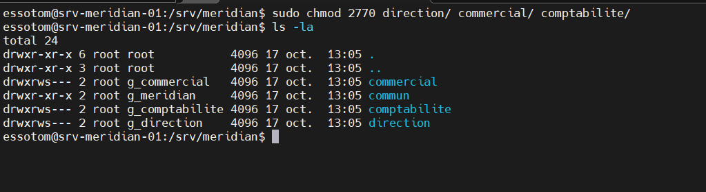

### 2.4 Répertoire commun : 3770 (EX-12, EX-15)

`commun` est ouvert en lecture et écriture à tout `g_meridian`. EX-15 demande en plus qu'on ne puisse supprimer que ses propres fichiers : c'est le sticky bit, qui vaut `1000`. Avec le setgid, on obtient `drwxrws--T`, soit `3770`. Le `T` majuscule indique le sticky bit sans droit `x` pour les autres.

```text
[SRV] $ sudo chmod 3770 /srv/meridian/commun
```

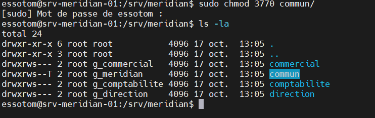

État final de l'arborescence, avec `exploitation` :

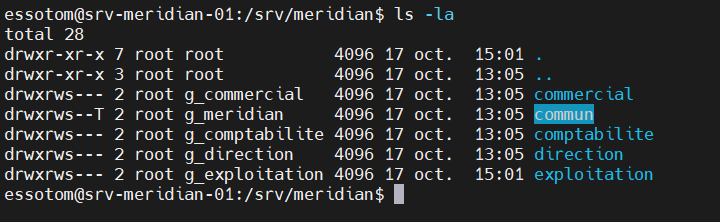

---

## 3. Accès de la comptabilité en lecture seule (EX-16 à EX-19)

### 3.1 Pourquoi des ACL

Un fichier n'a qu'un seul groupe propriétaire. Le répertoire `commercial` appartient à `g_commercial` ; on ne peut pas donner en plus un accès en lecture à `g_comptabilite` avec les seules permissions classiques, sauf à ouvrir le répertoire à "tous les autres", ce qui casserait le cloisonnement.

Les ACL POSIX permettent d'ajouter des droits pour un groupe supplémentaire sans toucher au propriétaire ni au groupe propriétaire (EX-19).

### 3.2 Installation

```text
[SRV] $ sudo apt update
[SRV] $ sudo apt install acl
```

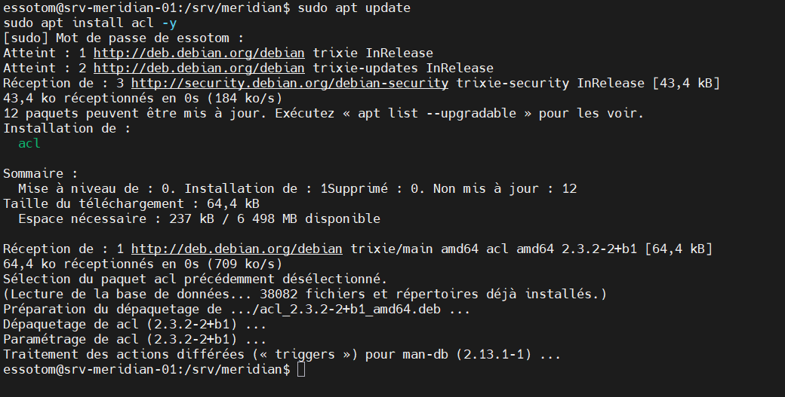

### 3.3 ACL d'accès

Elle donne à la comptabilité le droit de lister et traverser les trois répertoires dès maintenant (EX-16) :

```text
[SRV] $ sudo setfacl -m g:g_comptabilite:rx /srv/meridian/direction /srv/meridian/exploitation /srv/meridian/commercial
[SRV] $ sudo getfacl /srv/meridian/direction
```

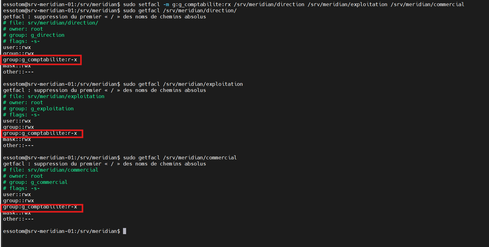

### 3.4 ACL par défaut

Elle est recopiée sur chaque fichier ou dossier créé ensuite dans le répertoire. C'est elle qui rend l'accès automatique pour les nouveaux fichiers (EX-17) :

```text
[SRV] $ sudo setfacl -d -m g:g_comptabilite:rx /srv/meridian/direction /srv/meridian/exploitation /srv/meridian/commercial
[SRV] $ sudo getfacl /srv/meridian/direction
```

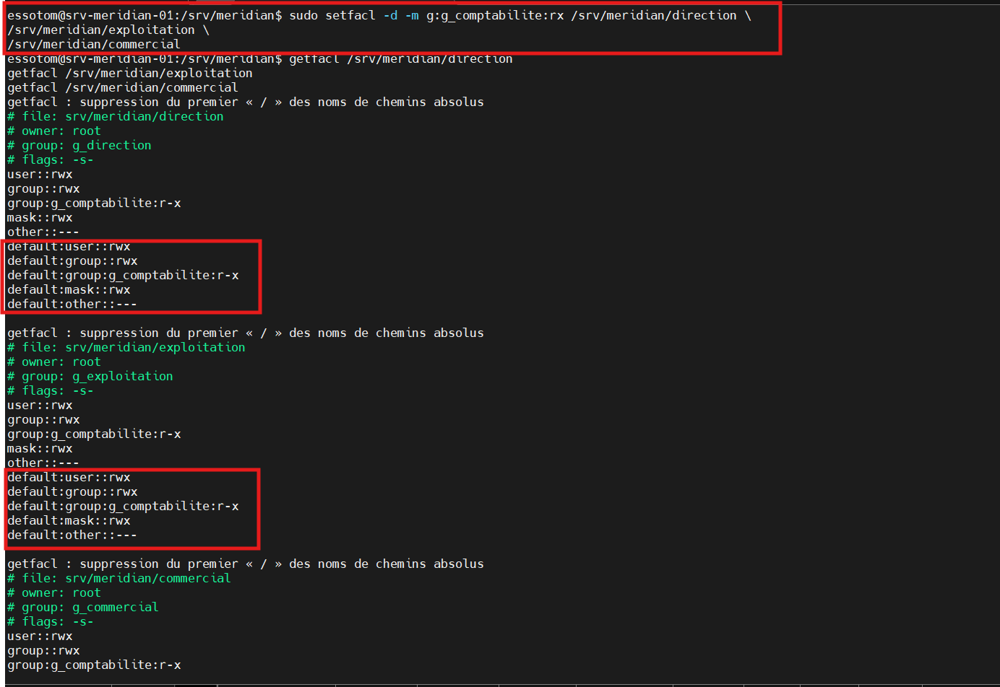

Les ACL ont été posées sur des répertoires vides, ce qui évite d'avoir à traiter des fichiers déjà présents.

La comptabilité n'a jamais `w` sur ces répertoires : elle ne peut ni créer ni supprimer de fichier (EX-18). Sur les fichiers, son droit réel est `r--` à cause du masque ACL (voir [recherches.md](recherches.md), question 4).

### 3.5 Travail en équipe dans `comptabilite` et `commun` (EX-14)

Ces deux répertoires n'avaient pas d'ACL par défaut. Les fichiers créés dedans suivaient l'umask `022` et étaient en `rw-r--r--` : un collègue pouvait les lire mais pas les modifier. On ajoute une ACL par défaut qui donne `rwx` au groupe propriétaire :

```text
[SRV] $ sudo setfacl -d -m g::rwx /srv/meridian/comptabilite /srv/meridian/commun
```

Les nouveaux fichiers sont alors en `rw-rw----`, quel que soit l'umask. Les fichiers créés avant cette commande gardent leurs droits.


