# Validation - Projet 02

Serveur : `srv-meridian-01`. Les tests sont lancés depuis le compte `essotom`, en prenant l'identité d'un salarié avec `sudo -u`. Chaque test reprend une commande de la section 6 du cahier des charges, avec sa sortie en texte, sa capture et un verdict.

## Récapitulatif

| Test | Exigences | Verdict |
|---|---|---|
| 6.1 Comptes et groupes | EX-01 à EX-08 | OK |
| 6.2 Arborescence | EX-09 à EX-13, EX-15 | OK |
| 6.3 Cloisonnement | EX-11 | OK |
| 6.4 Collaboration dans un service | EX-13, EX-14 | OK (`commercial` et `comptabilite`) |
| 6.5 Accès de la comptabilité | EX-16 à EX-19 | OK |
| 6.6 Sticky bit | EX-15 | OK |
| 6.7 Départ d'un collaborateur | EX-21, EX-22 | OK |
| 6.8 Persistance | Toutes | OK |

---

# 6.1 Comptes et groupes

### commande getent passwd | tail -15

**Sortie en texte :**

```bash
essotom@srv-meridian-01:~$ getent passwd | tail -15
sshd:x:989:65534:sshd user:/run/sshd:/usr/sbin/nologin
essotom:x:1000:1000:Essotom,,,:/home/essotom:/bin/bash
philippe.marchand:x:1001:1004::/home/philippe.marchand:/bin/bash
sylvie.ferrand:x:1002:1004::/home/sylvie.ferrand:/bin/bash
karim.benali:x:1003:1005::/home/karim.benali:/bin/bash
marc.dubois:x:1004:1005::/home/marc.dubois:/bin/bash
marie.dubois:x:1005:1005::/home/marie.dubois:/bin/bash
anne-sophie.lefevre-brun:x:1006:1005::/home/anne-sophie.lefevre-brun:/bin/bash
youssef.tahiri:x:1007:1005::/home/youssef.tahiri:/bin/bash
laura.mercier:x:1008:1006::/home/laura.mercier:/bin/bash
thomas.nguyen:x:1009:1006::/home/thomas.nguyen:/bin/bash
ines.vasquez:x:1010:1006::/home/ines.vasquez:/bin/bash
nathalie.roux:x:1011:1007::/home/nathalie.roux:/bin/bash
david.ostermann:x:1012:1007::/home/david.ostermann:/bin/bash
ext.comptable:x:1013:1007::/home/ext.comptable:/bin/bash
essotom@srv-meridian-01:~$
```

**Capture d'écran :**

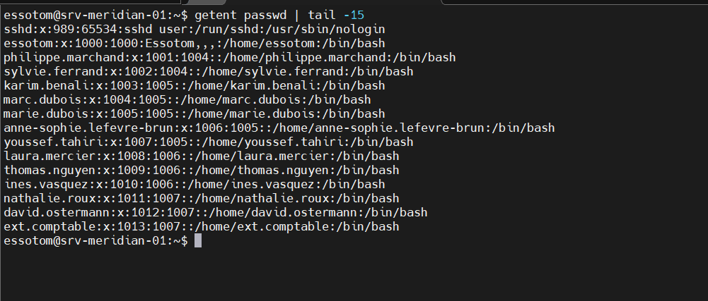

**Verdict :** OK (EX-01, EX-02). Les 13 comptes suivent la convention `prenom.nom`, ont un répertoire dans `/home` et le shell `/bin/bash`. Le GID de chaque compte est celui de son groupe de service.

### commande getent group | grep -E 'g_|sudo'

**Sortie en texte :**

```bash
essotom@srv-meridian-01:~$ getent group | grep -E 'g_|sudo'
sudo:x:27:essotom
g_meridian:x:1001:philippe.marchand,sylvie.ferrand,karim.benali,marc.dubois,marie.dubois,anne-sophie.lefevre-brun,youssef.tahiri,laura.mercier,thomas.nguyen,ines.vasquez,nathalie.roux,david.ostermann,ext.comptable
g_groupe:x:1002:
g_:x:1003:
g_direction:x:1004:
g_exploitation:x:1005:
g_commercial:x:1006:
g_comptabilite:x:1007:
essotom@srv-meridian-01:~$
```

**Capture d'écran :**

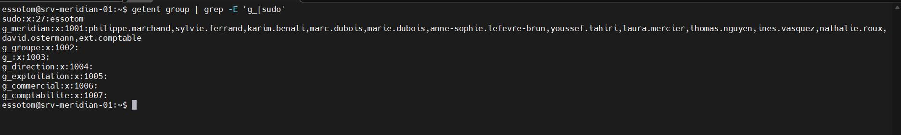

**Verdict :** OK (EX-05, EX-06, EX-07). `essotom` est le seul membre de `sudo`. Les quatre groupes de service existent et les 13 comptes sont dans `g_meridian`. Les groupes de service n'affichent pas de membres parce qu'ils sont groupes principaux : l'appartenance se lit dans le GID de `getent passwd`. `g_groupe` et `g_` sont des restes des essais du script. Ils étaient vides et ont été supprimés le 24/10/2026 avec `groupdel` (voir `JOURNAL.md` et la vérification ci-dessous).

### commande getent group | grep -E 'g_|sudo' (après suppression des groupes vides)

**Sortie en texte :**

```bash
essotom@srv-meridian-01:~$ getent group | grep -E 'g_|sudo'
sudo:x:27:essotom
g_meridian:x:1001:philippe.marchand,sylvie.ferrand,karim.benali,marc.dubois,marie.dubois,anne-sophie.lefevre-brun,youssef.tahiri,laura.mercier,thomas.nguyen,ines.vasquez,nathalie.roux,david.ostermann,ext.comptable
g_direction:x:1004:
g_exploitation:x:1005:
g_commercial:x:1006:
g_comptabilite:x:1007:
essotom@srv-meridian-01:~$
```

**Capture d'écran :**

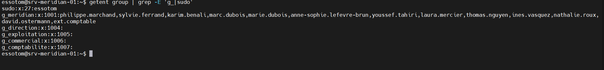

**Verdict :** OK. Il ne reste que `sudo`, `g_meridian` et les quatre groupes de service.

### commande sudo chage -l philippe.marchand

**Sortie en texte :**

```bash
essotom@srv-meridian-01:~$ sudo chage -l philippe.marchand
Dernière modification du mot de passe                                    : oct. 17, 2026
Le mot de passe expire                                   : janv. 15, 2027
Mot de passe inactif                                     : jamais
Le compte expire                                                 : jamais
Nombre minimal de jours entre deux changements de mot de passe           : 0
Nombre maximal de jours entre deux changements du mot de passe           : 90
Nombre de jours d'avertissements avant que le mot de passe n'expire      : 7
```

**Capture d'écran :**

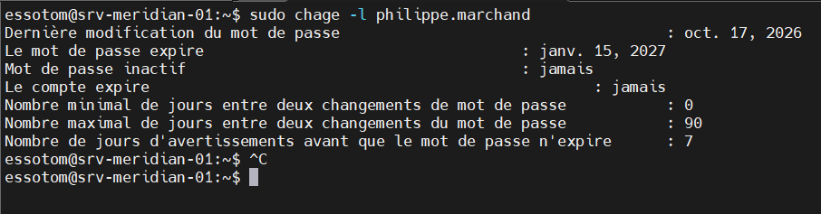

**Verdict :** OK (EX-03). Le mot de passe expire au bout de 90 jours, avec un avertissement 7 jours avant.

### commande sudo chage -l ext.comptable

**Sortie en texte :**

```bash
essotom@srv-meridian-01:~$ sudo chage -l ext.comptable
[sudo] Mot de passe de essotom :
Dernière modification du mot de passe                                    : oct. 17, 2026
Le mot de passe expire                                   : janv. 15, 2027
Mot de passe inactif                                     : jamais
Le compte expire                                                 : déc. 31, 2026
Nombre minimal de jours entre deux changements de mot de passe           : 0
Nombre maximal de jours entre deux changements du mot de passe           : 90
Nombre de jours d'avertissements avant que le mot de passe n'expire      : 7
essotom@srv-meridian-01:~$
```

**Capture d'écran :**

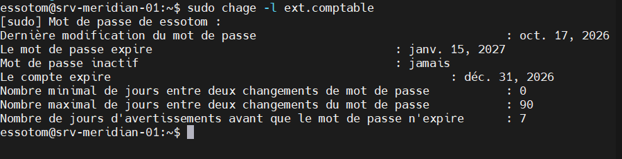

**Verdict :** OK (EX-04). Le compte expire le 31/12/2026 sans intervention.

### commande groups philippe.marchand

**Sortie en texte :**

```bash
essotom@srv-meridian-01:~$ groups philippe.marchand
philippe.marchand : g_direction g_meridian
essotom@srv-meridian-01:~$
```

**Capture d'écran :**

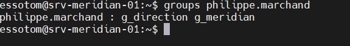

**Verdict :** OK (EX-08). Un seul groupe de service (`g_direction`, groupe principal) plus `g_meridian`.

---

# 6.2 Arborescence

### commande ls -ld /srv/meridian/*

**Sortie en texte :**

```bash
essotom@srv-meridian-01:~$ ls -ld /srv/meridian/*
drwxrws---+ 2 root g_commercial   4096 17 oct.  13:05 /srv/meridian/commercial
drwxrws--T  2 root g_meridian     4096 17 oct.  13:05 /srv/meridian/commun
drwxrws---  2 root g_comptabilite 4096 17 oct.  13:05 /srv/meridian/comptabilite
drwxrws---+ 2 root g_direction    4096 17 oct.  13:05 /srv/meridian/direction
drwxrws---+ 2 root g_exploitation 4096 17 oct.  15:01 /srv/meridian/exploitation
essotom@srv-meridian-01:~$
```

**Capture d'écran :**

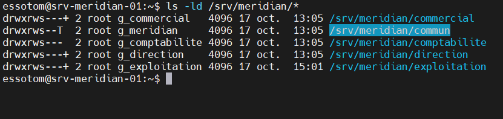

**Verdict :** OK (EX-09 à EX-13, EX-15). Les 5 répertoires sont dans `/srv/meridian`. Le `s` montre le setgid sur tous, le `T` le sticky bit sur `commun`, et le `+` les ACL sur `direction`, `exploitation` et `commercial`.

### commande stat -c '%A %U %G %n' /srv/meridian/*

**Sortie en texte :**

```bash
essotom@srv-meridian-01:~$ stat -c '%A %U %G %n' /srv/meridian/*
drwxrws--- root g_commercial /srv/meridian/commercial
drwxrws--T root g_meridian /srv/meridian/commun
drwxrws--- root g_comptabilite /srv/meridian/comptabilite
drwxrws--- root g_direction /srv/meridian/direction
drwxrws--- root g_exploitation /srv/meridian/exploitation
essotom@srv-meridian-01:~$
```

**Capture d'écran :**

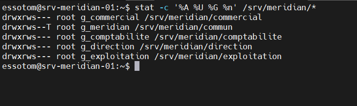

**Verdict :** OK. Chaque répertoire appartient à `root` et au groupe de son service. Les ACL n'ont pas changé le groupe propriétaire (EX-19).

---

# 6.3 Cloisonnement (ces tests doivent échouer)

### commande sudo -u laura.mercier ls /srv/meridian/direction/

**Sortie en texte :**

```bash
essotom@srv-meridian-01:~$ sudo -u laura.mercier ls /srv/meridian/direction/
ls: impossible d'ouvrir le répertoire '/srv/meridian/direction/': Permission non accordée
```

**Capture d'écran :**

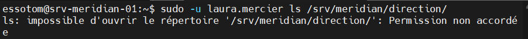

**Verdict :** OK (EX-11). Un commercial ne peut pas lister le répertoire de la direction.

### commande sudo -u laura.mercier touch /srv/meridian/direction/intrus.txt

**Sortie en texte :**

```bash
essotom@srv-meridian-01:~$ sudo -u laura.mercier touch /srv/meridian/direction/intrus.txt
touch: impossible de faire un touch '/srv/meridian/direction/intrus.txt': Permission non accordée
essotom@srv-meridian-01:~$
```

**Capture d'écran :**

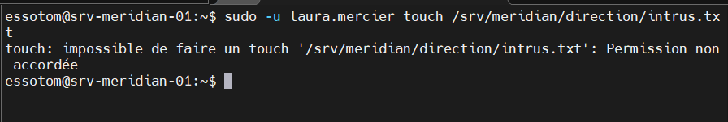

**Verdict :** OK (EX-11). Un commercial ne peut pas créer de fichier chez la direction.

### commande sudo -u youssef.tahiri cat /srv/meridian/comptabilite/Bilan-2026

Un fichier est d'abord créé dans `comptabilite` par `nathalie.roux`, puis un membre de l'exploitation essaie de le lire.

**Sortie en texte :**

```bash
essotom@srv-meridian-01:~$ sudo passwd nathalie.roux
Nouveau mot de passe :
Retapez le nouveau mot de passe :
passwd : mot de passe mis à jour avec succès
essotom@srv-meridian-01:~$ sudo -u nathalie.roux touch /srv/meridian/comptabilite/Bilan-2026
essotom@srv-meridian-01:~$ sudo -u nathalie.roux ls /srv/meridian/comptabilite/
Bilan-2026
essotom@srv-meridian-01:~$ sudo -u youssef.tahiri cat /srv/meridian/comptabilite/Bilan-2026
cat: /srv/meridian/comptabilite/Bilan-2026: Permission non accordée
essotom@srv-meridian-01:~$
```

**Capture d'écran :**

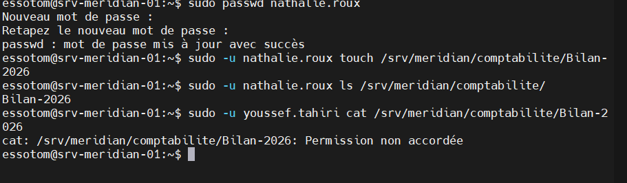

**Verdict :** OK (EX-11). La comptable crée un fichier dans son répertoire. Un membre de l'exploitation ne peut pas le lire, même en connaissant son nom : il ne peut pas traverser le répertoire.

---

# 6.4 Collaboration dans un service

**Scénario de test :**

```bash
sudo -u <commercial_1> touch /srv/meridian/commercial/devis-2026.txt
ls -l /srv/meridian/commercial/devis-2026.txt      # groupe = g_commercial
sudo -u <commercial_2> sh -c 'echo "ligne ajoutée" >> /srv/meridian/commercial/devis-2026.txt'
```

**Sortie en texte :**

```bash
essotom@srv-meridian-01:~$ sudo -u laura.mercier touch /srv/meridian/commercial/devis-2026.txt
essotom@srv-meridian-01:~$ sudo -i ls -l /srv/meridian/commercial/devis-2026.txt
-rw-rw----+ 1 laura.mercier g_commercial 0 20 oct.  21:52 /srv/meridian/commercial/devis-2026.txt
essotom@srv-meridian-01:~$ sudo -i cat /srv/meridian/commercial/devis-2026.txt
essotom@srv-meridian-01:~$ sudo -u thomas.nguyen sh -c 'echo "ligne ajoutée" >> /srv/meridian/commercial/devis-2026.txt'
essotom@srv-meridian-01:~$ sudo -i cat /srv/meridian/commercial/devis-2026.txt
ligne ajoutée
essotom@srv-meridian-01:~$
```

**Capture d'écran :**

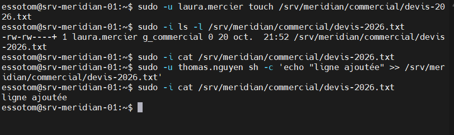

**Verdict :** OK (EX-13, EX-14). Le fichier créé par `laura.mercier` appartient à `g_commercial` et `thomas.nguyen` peut y écrire. Le droit `rw-` du groupe vient de l'ACL par défaut du répertoire.

Remarque sur EX-13 : `laura.mercier` a déjà `g_commercial` comme groupe principal, ce test seul ne prouve donc pas le setgid. La preuve est dans le test 6.7 : `test.depart`, groupe principal `g_commercial`, a créé `note-test-depart.txt` dans `commun`, et le fichier a pris le groupe `g_meridian`.

### Complément : collaboration dans comptabilite

Le répertoire `comptabilite` n'avait pas d'ACL par défaut : ses fichiers suivaient l'umask `022` et n'étaient pas modifiables par le groupe. Une ACL par défaut a été ajoutée (voir [mise-en-oeuvre.md](mise-en-oeuvre.md), section 3.5), puis le test a été rejoué avec deux comptables.

**Sortie en texte :**

```bash
essotom@srv-meridian-01:~$ sudo setfacl -d -m g::rwx /srv/meridian/comptabilite /srv/meridian/commun
essotom@srv-meridian-01:~$ sudo -u nathalie.roux touch /srv/meridian/comptabilite/test-ex14.txt
essotom@srv-meridian-01:~$ sudo -u david.ostermann sh -c 'echo ok >> /srv/meridian/comptabilite/test-ex14.txt'
essotom@srv-meridian-01:~$ sudo -u david.ostermann cat  /srv/meridian/comptabilite/test-ex14.txt
ok
```

**Capture d'écran :**

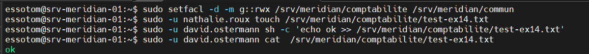

**Verdict :** OK (EX-14). `david.ostermann` ajoute une ligne au fichier créé par `nathalie.roux`, sans intervention de l'administrateur.

---

# 6.5 Accès de la comptabilité

**Scénario de test :**

```bash
getfacl /srv/meridian/commercial
sudo -u <comptable> cat /srv/meridian/commercial/devis-2026.txt        # doit réussir
sudo -u <comptable> touch /srv/meridian/commercial/test.txt            # doit échouer
sudo -u <commercial_1> touch /srv/meridian/commercial/nouveau.txt
getfacl /srv/meridian/commercial/nouveau.txt                           # ACL héritée
sudo -u <comptable> cat /srv/meridian/commercial/nouveau.txt           # doit réussir
```

Le `getfacl` du répertoire `commercial` est dans [mise-en-oeuvre.md](mise-en-oeuvre.md), section 3.4.

**Sortie en texte :**

```bash
essotom@srv-meridian-01:~$ sudo -u nathalie.roux cat /srv/meridian/commercial/devis-2026.txt
ligne ajoutée
essotom@srv-meridian-01:~$ sudo -u nathalie.roux touch /srv/meridian/commercial/test.txt
touch: impossible de faire un touch '/srv/meridian/commercial/test.txt': Permission non accordée
essotom@srv-meridian-01:~$ sudo -u laura.mercier touch /srv/meridian/commercial/nouveau.txt
essotom@srv-meridian-01:~$ sudo -u laura.mercier ls /srv/meridian/commercial/
devis-2026.txt  nouveau.txt
essotom@srv-meridian-01:~$ sudo getfacl /srv/meridian/commercial/nouveau.txt
getfacl : suppression du premier « / » des noms de chemins absolus
# file: srv/meridian/commercial/nouveau.txt
# owner: laura.mercier
# group: g_commercial
user::rw-
group::rwx                      #effective:rw-
group:g_comptabilite:r-x        #effective:r--
mask::rw-
other::---

essotom@srv-meridian-01:~$ sudo -u laura.mercier nano /srv/meridian/commercial/nouveau.txt
essotom@srv-meridian-01:~$ sudo -u nathalie.roux cat /srv/meridian/commercial/nouveau.txt
Contenu de Nouveau.txt
```

**Capture d'écran :**

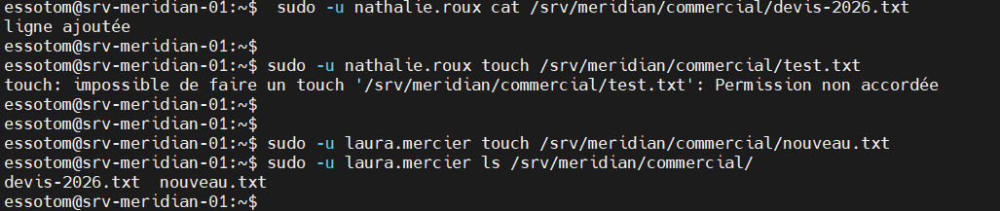

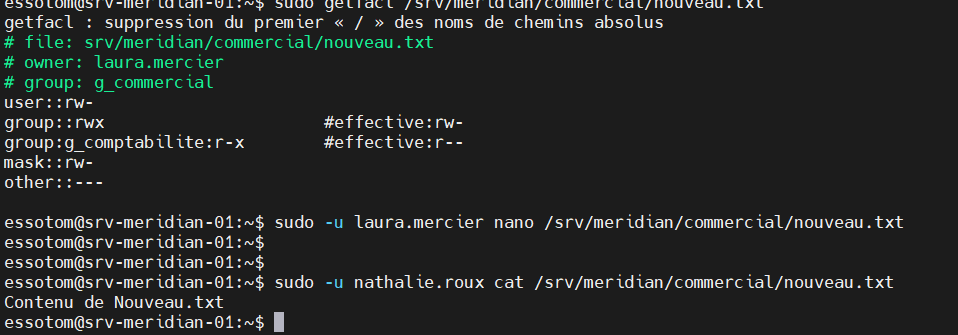

**Verdict :** OK (EX-16 à EX-19).

- EX-16 : la comptable lit un fichier du service commercial.
- EX-17 : `nouveau.txt`, créé après la pose des ACL, porte automatiquement `group:g_comptabilite`.
- EX-18 : la création est refusée. Le droit réel de la comptabilité sur le fichier est `r--` (`#effective`), elle ne peut donc pas le modifier. Elle n'a pas `w` sur le répertoire, elle ne peut donc pas supprimer de fichier.
- EX-19 : le groupe propriétaire reste `g_commercial`.

---

# 6.6 Sticky bit

**Scénario de test :**

```bash
sudo -u <utilisateur_A> touch /srv/meridian/commun/note-A.txt
sudo -u <utilisateur_B> rm /srv/meridian/commun/note-A.txt    # doit échouer
sudo -u <utilisateur_A> rm /srv/meridian/commun/note-A.txt    # doit réussir
```

**Sortie en texte :**

```bash
essotom@srv-meridian-01:~$ sudo -u philippe.marchand touch /srv/meridian/commun/note-A.txt
essotom@srv-meridian-01:~$ sudo -u philippe.marchand ls /srv/meridian/commun/note-A.txt
/srv/meridian/commun/note-A.txt
essotom@srv-meridian-01:~$ sudo -u david.ostermann rm /srv/meridian/commun/note-A.txt
rm : supprimer '/srv/meridian/commun/note-A.txt' qui est protégé en écriture et est du type « regular empty file » ? oui
rm: impossible de supprimer '/srv/meridian/commun/note-A.txt': Opération non permise
essotom@srv-meridian-01:~$ sudo -u philippe.marchand ls /srv/meridian/commun/note-A.txt
/srv/meridian/commun/note-A.txt
essotom@srv-meridian-01:~$ sudo -u philippe.marchand rm /srv/meridian/commun/note-A.txt
essotom@srv-meridian-01:~$ sudo -u philippe.marchand ls /srv/meridian/commun/note-A.txt
ls: impossible d'accéder à '/srv/meridian/commun/note-A.txt': Aucun fichier ou dossier de ce nom
essotom@srv-meridian-01:~$
```

**Capture d'écran :**

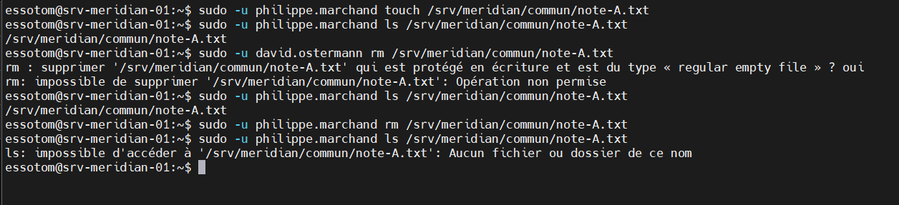

**Verdict :** OK (EX-12, EX-15). Un membre de la direction crée un fichier dans `commun`. Un comptable ne peut pas le supprimer, son propriétaire le peut. Le message "protégé en écriture" montre que le fichier n'est pas modifiable par le groupe : le fichier suivait alors l'umask `022`. Ce point a été corrigé depuis par une ACL par défaut sur `commun` (voir le complément du test 6.4).

---

# 6.7 Départ d'un collaborateur

La procédure [docs/procedure-depart.md](../docs/procedure-depart.md) a été exécutée sur un compte de test, `test.depart`, rattaché au service commercial. Le successeur désigné pour ses données est `laura.mercier`.

Le test se fait en trois temps : on montre d'abord que le compte fonctionne, on applique ensuite la procédure, puis on vérifie que l'accès est coupé et que les données sont toujours là.

## 1. Avant le départ : le compte fonctionne

Le compte a été créé comme les autres salariés (groupe principal `g_commercial`, groupe secondaire `g_meridian`, expiration du mot de passe à 90 jours). Une clé SSH lui a été déposée dans `/home/test.depart/.ssh/authorized_keys`.

### commande ssh -i id_ed25519_testdepart test.depart@192.168.56.10 (depuis l'hôte)

**Sortie en texte :**

```bash
C:\Users\Hugues BLAKIME\Documents\LAB>ssh -i id_ed25519_testdepart test.depart@192.168.56.10
*******************************************************************
*                          ACCÈS RESTREINT                        *
*                                                                 *
* Serveur : srv-meridian-01                                       *
*                                                                 *
* Toute connexion est réservée aux utilisateurs autorisés.        *
* Toute activité peut être journalisée et contrôlée.              *
*                                                                 *
* Toute tentative d'accès non autorisée est interdite.            *
*******************************************************************
Enter passphrase for key 'id_ed25519_testdepart':
Linux srv-meridian-01 6.12.105+deb13-amd64 #1 SMP PREEMPT_DYNAMIC Debian 6.12.105-1 (2026-08-24) x86_64
[...]
test.depart@srv-meridian-01:~$ id
uid=1014(test.depart) gid=1006(g_commercial) groupes=1006(g_commercial),1001(g_meridian)
test.depart@srv-meridian-01:~$ echo "Devis client X" > /srv/meridian/commercial/devis-test-depart.txt
test.depart@srv-meridian-01:~$ echo "Note commune" > /srv/meridian/commun/note-test-depart.txt
test.depart@srv-meridian-01:~$ echo "brouillon perso" > ~/brouillon.txt
test.depart@srv-meridian-01:~$ ls -l /srv/meridian/commercial/devis-test-depart.txt
-rw-rw----+ 1 test.depart g_commercial 15 22 oct.  15:11 /srv/meridian/commercial/devis-test-depart.txt
test.depart@srv-meridian-01:~$
```

**Capture d'écran :**

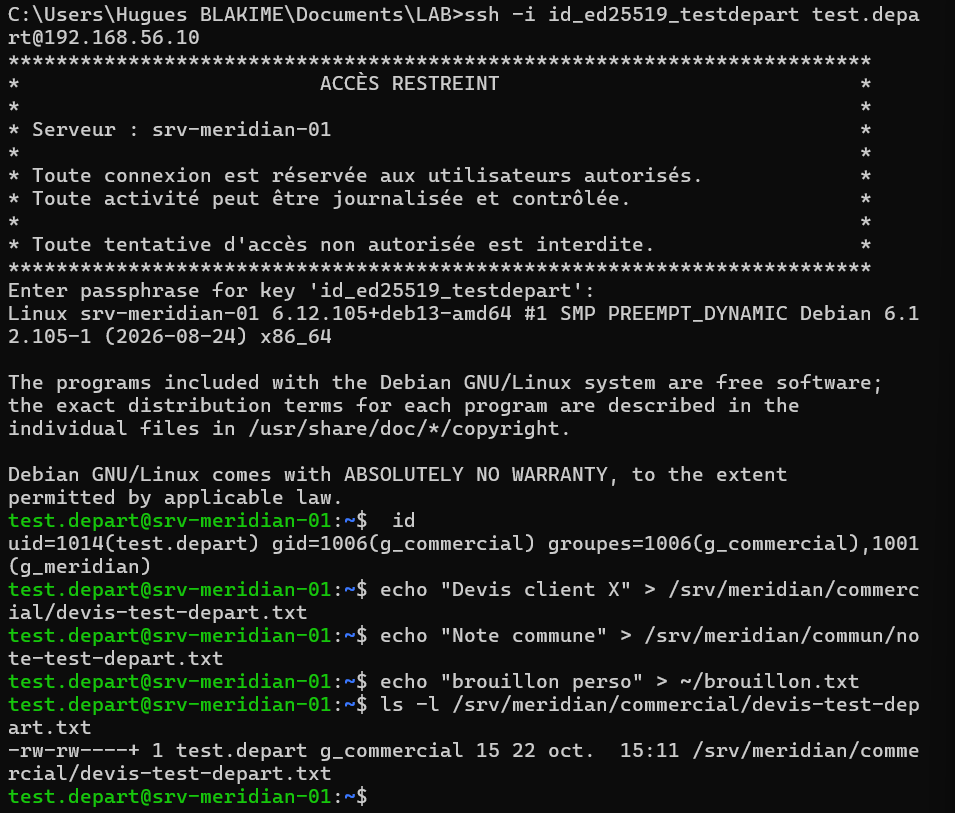

**Verdict :** OK. La connexion par clé fonctionne et le compte a laissé des fichiers dans son service, dans `commun` et dans son répertoire personnel.

### commande su - test.depart -c id (depuis essotom, sans sudo)

**Sortie en texte :**

```bash
essotom@srv-meridian-01:~$ su - test.depart -c id
Mot de passe :
su: Échec de l'authentification
essotom@srv-meridian-01:~$
```

**Capture d'écran :**

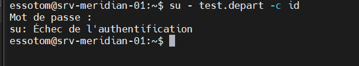

**Verdict :** non probant. Le mot de passe saisi n'a pas été accepté alors que le compte était encore actif. Ce test ne peut donc pas servir de point de comparaison. Il est remplacé par le test suivant.

### commande sudo su - test.depart -c id

**Sortie en texte :**

```bash
essotom@srv-meridian-01:~$ sudo su - test.depart -c id
uid=1014(test.depart) gid=1006(g_commercial) groupes=1006(g_commercial),1001(g_meridian)
essotom@srv-meridian-01:~$
```

**Capture d'écran :**

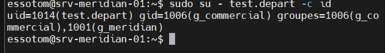

**Verdict :** OK. Avant le départ, on peut prendre l'identité de `test.depart`.

---

## 2. Exécution de la procédure

Toutes les commandes sont lancées en root avec `U=test.depart`.

### Étape 0 : état des lieux

**Sortie en texte :**

```bash
root@srv-meridian-01:~# U=test.depart
root@srv-meridian-01:~# id $U
uid=1014(test.depart) gid=1006(g_commercial) groupes=1006(g_commercial),1001(g_meridian)
root@srv-meridian-01:~# chage -l $U
Dernière modification du mot de passe                                    : oct. 22, 2026
Le mot de passe expire                                   : janv. 20, 2027
Mot de passe inactif                                     : jamais
Le compte expire                                                 : jamais
Nombre minimal de jours entre deux changements de mot de passe           : 0
Nombre maximal de jours entre deux changements du mot de passe           : 90
Nombre de jours d'avertissements avant que le mot de passe n'expire      : 7
root@srv-meridian-01:~# lastlog -u $U
-bash: lastlog : commande introuvable
root@srv-meridian-01:~# loginctl list-sessions
SESSION  UID USER    SEAT LEADER CLASS   TTY IDLE SINCE
     26 1000 essotom -    95772  user    -   no   -
     28 1000 essotom -    95781  manager -   no   -

2 sessions listed.
root@srv-meridian-01:~# crontab -l -u $U
no crontab for test.depart
root@srv-meridian-01:~# du -sh /home/$U
32K     /home/test.depart
root@srv-meridian-01:~#
```

**Capture d'écran :**

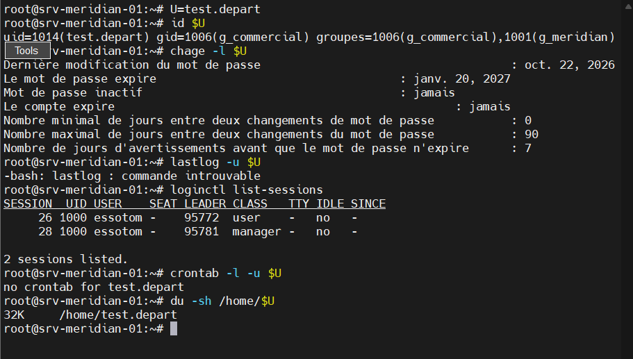

**Verdict :** OK. Remarque : `lastlog` n'existe pas sur Debian 13. L'étape 0 de la procédure doit être corrigée.

### Étapes 1 à 7 : blocage de l'accès

**Sortie en texte :**

```bash
root@srv-meridian-01:~# usermod -L $U
root@srv-meridian-01:~# passwd -S $U
test.depart L 2026-10-22 0 90 7 -1
root@srv-meridian-01:~# usermod -e 1 $U
root@srv-meridian-01:~# chage -l $U
Dernière modification du mot de passe                                    : oct. 22, 2026
Le mot de passe expire                                   : janv. 20, 2027
Mot de passe inactif                                     : jamais
Le compte expire                                                 : janv. 02, 1970
Nombre minimal de jours entre deux changements de mot de passe           : 0
Nombre maximal de jours entre deux changements du mot de passe           : 90
Nombre de jours d'avertissements avant que le mot de passe n'expire      : 7
root@srv-meridian-01:~# usermod -s /usr/sbin/nologin $U
root@srv-meridian-01:~# getent passwd $U
test.depart:x:1014:1006::/home/test.depart:/usr/sbin/nologin
root@srv-meridian-01:~# mv /home/$U/.ssh/authorized_keys /home/$U/.ssh/authorized_keys.depart
root@srv-meridian-01:~# loginctl terminate-user $U
Could not terminate user: User ID 1014 is not logged in or lingering
root@srv-meridian-01:~# crontab -l -u $U
no crontab for test.depart
root@srv-meridian-01:~# loginctl disable-linger $U
root@srv-meridian-01:~#
```

**Capture d'écran :**

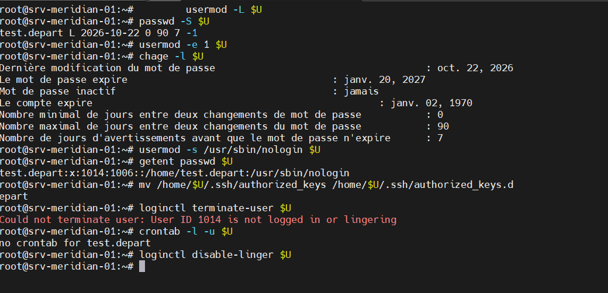

**Verdict :** OK. Le mot de passe est verrouillé (`L`), le compte a expiré et le shell est `/usr/sbin/nologin`. Le message de `loginctl terminate-user` est normal : `test.depart` n'avait pas de session ouverte.

### Étape 8 : retrait des groupes

**Sortie en texte :**

```bash
root@srv-meridian-01:~# gpasswd -d $U g_meridian
Suppression de l'utilisateur test.depart du groupe g_meridian
root@srv-meridian-01:~# id $U
uid=1014(test.depart) gid=1006(g_commercial) groupes=1006(g_commercial)
root@srv-meridian-01:~#
```

**Capture d'écran :**

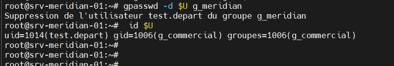

**Verdict :** OK pour le groupe secondaire. `g_commercial` reste affiché parce que c'est le groupe principal du compte, et `gpasswd -d` ne peut pas le retirer. Le contrôle attendu dans la procédure ("ne montre plus que son groupe personnel") ne correspond pas à notre organisation et doit être corrigé.

### Étapes 11 à 13 : archivage du répertoire personnel

Premier essai, en échec :

```bash
root@srv-meridian-01:~# install -d -m 700 -o root -g root /srv/archives/départs &&
A=/srv/archives/departs/$U-$(date +%Y%m%d).tar.gz &&
tar --numeric-owner --acls --xattrs -czpf $A -C /home $U &&
chmod 600 $A &&
sha256sum $A &&
tar -tzf $A &&
>
> ls
tar (child): /srv/archives/departs/test.depart-20261024.tar.gz : open impossible: Aucun fichier ou dossier de ce nom
tar (child): Error is not recoverable: exiting now
tar: /srv/archives/departs/test.depart-20261024.tar.gz : write impossible: Relais brisé (pipe)
tar: Child returned status 2
tar: Error is not recoverable: exiting now
root@srv-meridian-01:~#
```

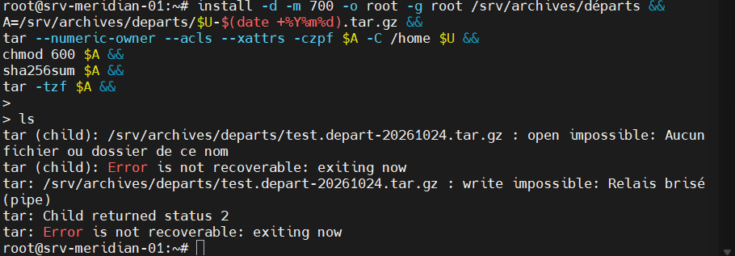

Le répertoire a été créé sous le nom `départs` (avec un accent), alors que `tar` écrivait dans `departs`. Correction :

```bash
root@srv-meridian-01:~# ls -la /srv/archives/
total 12
drwxr-xr-x 3 root root 4096 24 oct.  10:56 .
drwxr-xr-x 4 root root 4096 24 oct.  10:52 ..
drwx------ 2 root root 4096 24 oct.  10:56 départs
root@srv-meridian-01:~# rmdir "/srv/archives/départs"
root@srv-meridian-01:~# install -d -m 700 -o root -g root /srv/archives/departs
root@srv-meridian-01:~# ls -ld /srv/archives/departs
drwx------ 2 root root 4096 24 oct.  10:57 /srv/archives/departs
root@srv-meridian-01:~# echo "$U / $A"
test.depart / /srv/archives/departs/test.depart-20261024.tar.gz
root@srv-meridian-01:~#
```

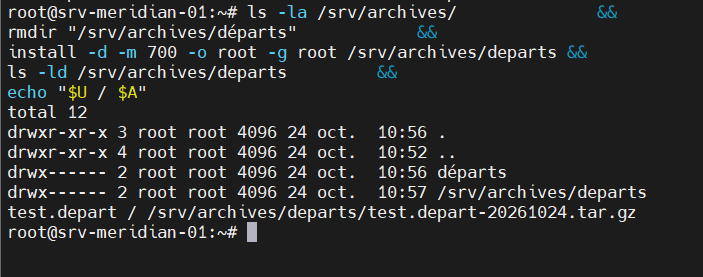

Deuxième essai :

**Sortie en texte :**

```bash
root@srv-meridian-01:~# tar --numeric-owner --acls --xattrs -czpf $A -C /home $U
root@srv-meridian-01:~# chmod 600 $A
root@srv-meridian-01:~# sha256sum $A
5eac03810311ae689b3de11c730dd099bcfac2a5e178baa70920a71c83ea318f  /srv/archives/departs/test.depart-20261024.tar.gz
root@srv-meridian-01:~# tar -tzf $A
test.depart/
test.depart/.bash_logout
test.depart/brouillon.txt
test.depart/.profile
test.depart/.ssh/
test.depart/.ssh/authorized_keys.depart
test.depart/.bashrc
test.depart/.bash_history
root@srv-meridian-01:~#
```

**Capture d'écran :**

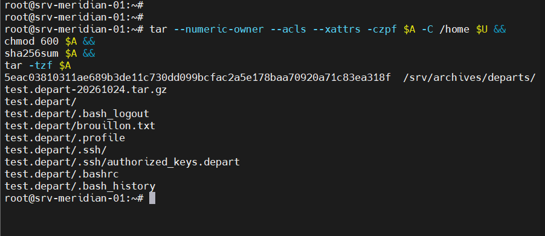

**Verdict :** OK. L'archive contient le répertoire personnel, y compris `brouillon.txt`.

### Étapes 14 à 16 : transfert des fichiers partagés au successeur

**Sortie en texte :**

```bash
root@srv-meridian-01:~# find /srv/meridian -user $U -ls
       60      4 -rw-rw----   1 test.depart g_commercial       15 oct. 22 15:11 /srv/meridian/commercial/devis-test-depart.txt
       61      4 -rw-r--r--   1 test.depart g_meridian         13 oct. 22 15:11 /srv/meridian/commun/note-test-depart.txt
root@srv-meridian-01:~# find /srv/meridian -user $U -exec chown -h laura.mercier {} +
root@srv-meridian-01:~# find /srv/meridian -user $U -ls
root@srv-meridian-01:~# find /srv/meridian/commercial -user laura.mercier ! -group g_commercial -ls
root@srv-meridian-01:~#
```

**Capture d'écran :**

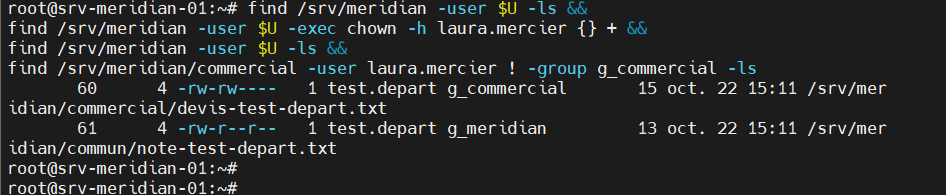

**Verdict :** OK. Les deux fichiers appartiennent maintenant à `laura.mercier`, plus aucun fichier n'est au nom de `test.depart`, et le groupe `g_commercial` est conservé.

### Étape 17 : suppression définitive

Non exécutée, et c'est volontaire : la procédure prévoit 30 jours de rétention avant `userdel -r`.

---

## 3. Après le départ : l'accès est coupé, les données sont conservées

### commande sudo chage -l test.depart

**Sortie en texte :**

```bash
root@srv-meridian-01:~# sudo chage -l test.depart
Dernière modification du mot de passe                                    : oct. 22, 2026
Le mot de passe expire                                   : janv. 20, 2027
Mot de passe inactif                                     : jamais
Le compte expire                                                 : janv. 02, 1970
Nombre minimal de jours entre deux changements de mot de passe           : 0
Nombre maximal de jours entre deux changements du mot de passe           : 90
Nombre de jours d'avertissements avant que le mot de passe n'expire      : 7
root@srv-meridian-01:~#
```

**Capture d'écran :**

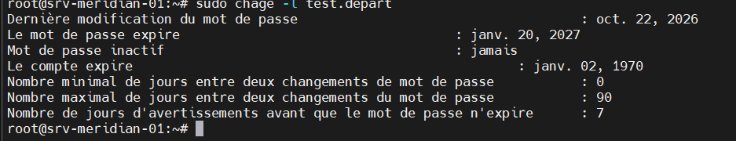

**Verdict :** OK. Le compte est expiré.

### commande ssh -i id_ed25519_testdepart test.depart@192.168.56.10 (depuis l'hôte)

**Sortie en texte :**

```bash
C:\Users\Hugues BLAKIME\Documents\LAB>ssh -i id_ed25519_testdepart test.depart@192.168.56.10
*******************************************************************
*                          ACCÈS RESTREINT                        *
[...]
*******************************************************************
test.depart@192.168.56.10: Permission denied (publickey).

C:\Users\Hugues BLAKIME\Documents\LAB>
```

**Capture d'écran :**

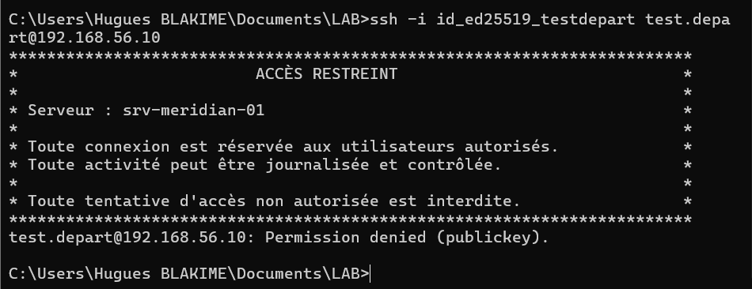

**Verdict :** OK (EX-22). Avec la même clé que dans la partie 1, la connexion est maintenant refusée. Ici, le refus vient du retrait de `authorized_keys` (étape 4). L'effet de l'expiration seule sur une connexion par clé n'a pas été testé séparément.

### commande sudo su - test.depart

**Sortie en texte :**

```bash
essotom@srv-meridian-01:~$ sudo su - test.depart
[sudo] Mot de passe de essotom :
Votre compte a expiré ; veuillez contacter votre administrateur système.
su: Échec de l'authentification
essotom@srv-meridian-01:~$
```

**Capture d'écran :**

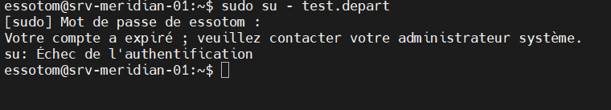

**Verdict :** OK (EX-22). La même commande fonctionnait dans la partie 1. Maintenant, `su` refuse à cause de l'expiration du compte, même lancé par root.

### commandes de contrôle des données et du journal

**Sortie en texte :**

```bash
essotom@srv-meridian-01:~$ sudo -u laura.mercier ls -l /srv/meridian/commercial/
total 12
-rw-rw----+ 1 laura.mercier g_commercial 15 20 oct.  21:53 devis-2026.txt
-rw-rw----+ 1 laura.mercier g_commercial 15 22 oct.  15:11 devis-test-depart.txt
-rw-rw----+ 1 laura.mercier g_commercial 23 22 oct.  12:05 nouveau.txt
essotom@srv-meridian-01:~$ sudo -u laura.mercier cat /srv/meridian/commercial/devis-test-depart.txt
Devis client X
essotom@srv-meridian-01:~$ sudo journalctl -u ssh --since today | grep test.depart
oct. 24 11:03:46 srv-meridian-01 sshd-session[398410]: Connection reset by authenticating user test.depart 192.168.56.1 port 54393 [preauth]
essotom@srv-meridian-01:~$
```

**Capture d'écran :**

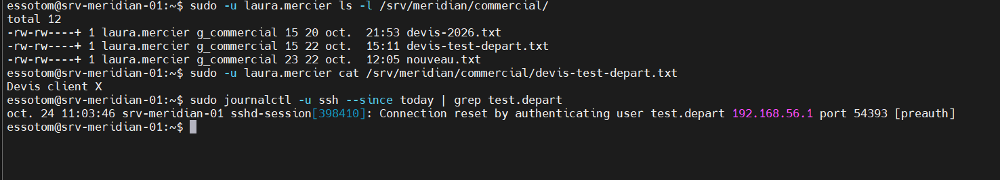

**Verdict :** OK (EX-21). Le devis créé par `test.depart` est toujours dans le répertoire du service et lisible par `laura.mercier`. Le journal du 24 octobre montre la tentative refusée, sans aucune connexion acceptée. Sur Debian 13, ces lignes sont écrites par `sshd-session` et non par `sshd`, ce qui confirme qu'il faut corriger l'étape 20 de la procédure (`_COMM=sshd`).

---

# 6.8 Persistance

La VM a été redémarrée, puis les tests 6.2, 6.3 et 6.5 ont été rejoués. Les résultats sont identiques à ceux consignés plus haut. Les sorties de cette seconde exécution n'ont pas été conservées.

Les permissions, le setgid, le sticky bit et les ACL sont enregistrés dans le système de fichiers : ils ne dépendent d'aucun service à relancer au démarrage. Les comptes et les groupes sont dans `/etc/passwd`, `/etc/group` et `/etc/shadow`.

**Verdict :** OK.
